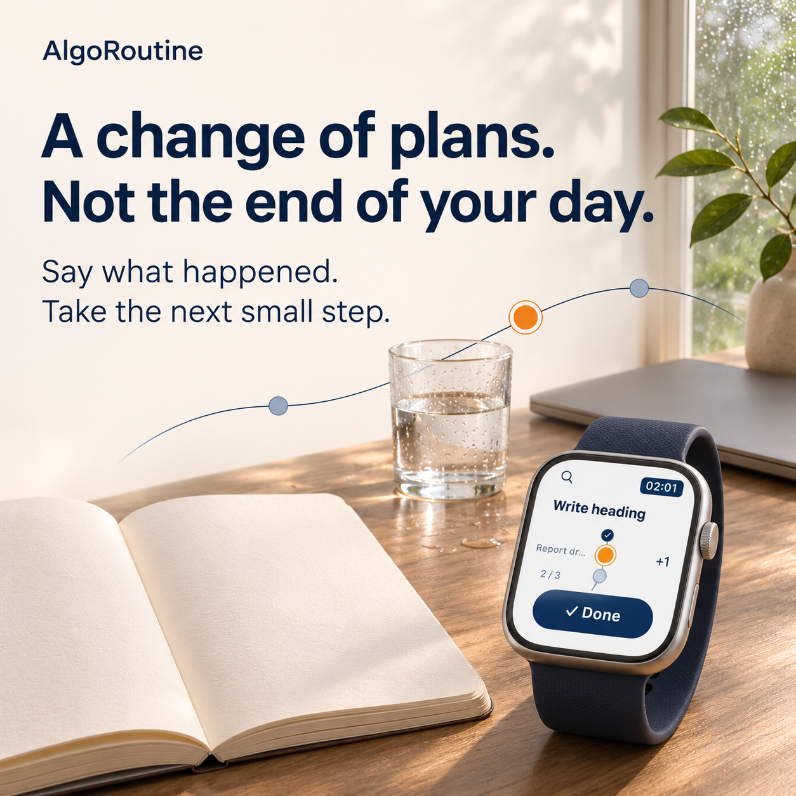
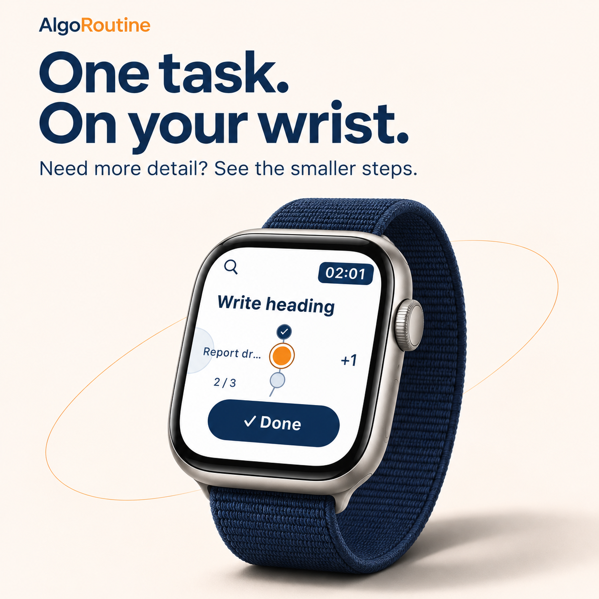
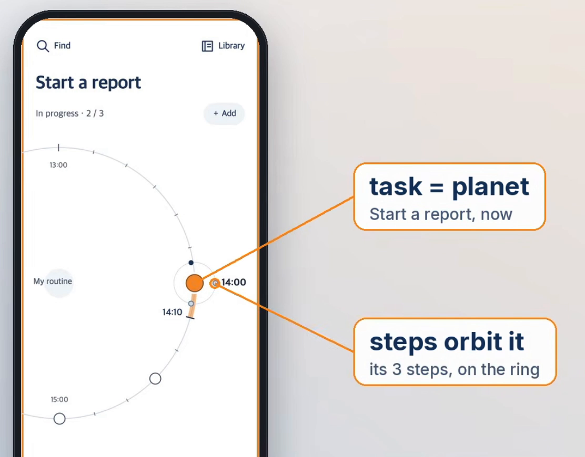
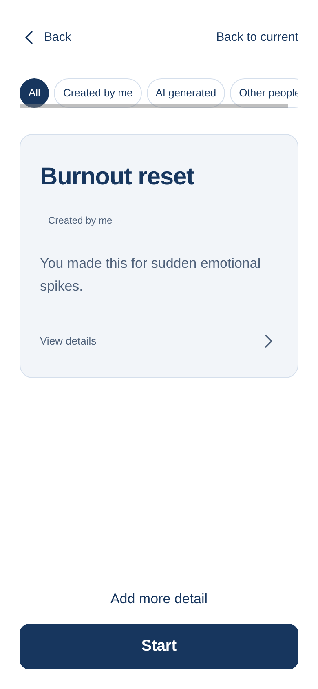
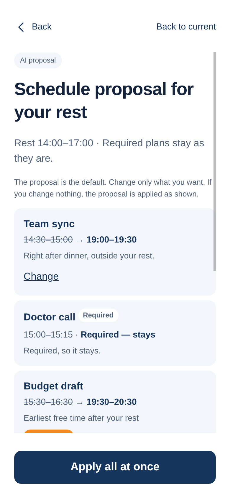
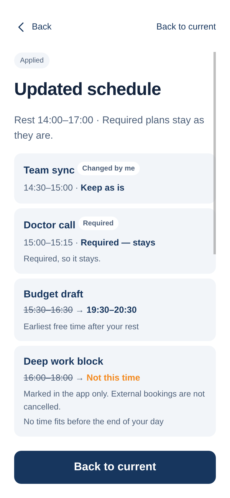
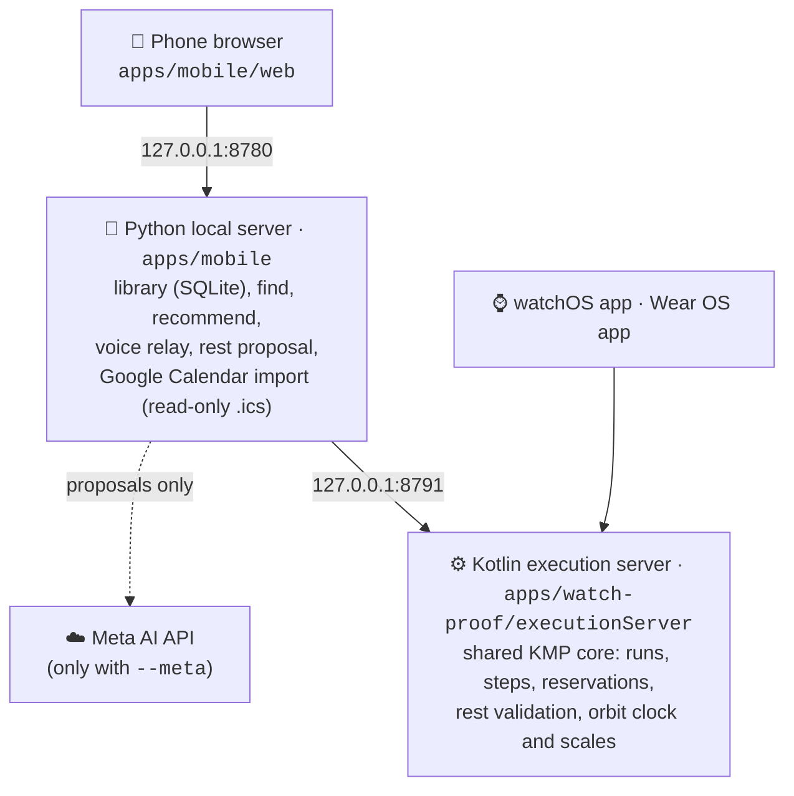

# AlgoRoutine

**Stop safely. Come back to where you were.**

<table>
  <tr>
    <td width="50%"></td>
    <td width="50%"></td>
  </tr>
</table>

AlgoRoutine is a routine-and-schedule app for moments when your day suddenly falls apart. You say what is happening and it finds a small routine to run. If you need rest, it rearranges the rest of your day in one step. A watch walks you through one step at a time, and your place is kept so you can pick up again later.

<p align="center">
  <a href="https://www.youtube.com/watch?v=YLBn9VvBgFQ">
    
  </a>
  <br>
  <sub>▶ <a href="https://www.youtube.com/watch?v=YLBn9VvBgFQ">Watch the demo on YouTube</a></sub>
</p>

## Your day is an orbit

<p align="center">
  
</p>

Instead of a list, your day is drawn as a clock.

- **The orange planet is what you're doing now.** It sits at the real time on the orbit (here, *Start a report* at 14:00).
- **Every other task sits at its own time.** The empty circles further along the orbit are what comes next.
- **Each task's steps orbit the planet.** Go one level down and that small ring becomes the whole clock, so you can follow one step at a time.

You can turn the clock to look around; one tap on the orange planet brings you back to "now".

## In 30 seconds

You're in the middle of a busy afternoon and suddenly can't go on. Here is what AlgoRoutine does in three screens:

<table>
  <tr>
    <td align="center" width="33%"></td>
    <td align="center" width="33%"></td>
    <td align="center" width="33%"></td>
  </tr>
  <tr>
    <td valign="top"><b>1. Say what's happening</b><br>You type "I suddenly started crying. I can't focus anymore." It picks <i>Burnout reset</i>, a routine you made earlier for exactly this. Press <b>Start</b>.</td>
    <td valign="top"><b>2. See the plan for your rest</b><br>Rest is 14:00–17:00. Plans that can move are shifted to after your rest; the required <i>Doctor call</i> stays. Change only what you want.</td>
    <td valign="top"><b>3. Apply all at once</b><br>The day is updated in one step. Here you kept <i>Team sync</i>, and <i>Deep work block</i> is marked <i>Not this time</i> because nothing fits before your day ends.</td>
  </tr>
</table>

Then the watch shows one small step at a time, and if you're interrupted, your place is kept.

## What it does

1. **Say it → Meta recommends.** Type or speak a sentence like "I suddenly started crying. I can't focus anymore." Meta AI reads it and picks the routine that fits.
2. **Your routines first.** It picks from routines you made or saved. If none fits, it drafts a new short routine. You see every step before you press Start.
3. **Rest without losing the day.** Starting a rest routine opens one batch proposal for the plans it pushes aside: **Shift** (Shift to another time), Not this time, Keep as is, or Decide later myself. Meta proposes and the app's rules check every item. An item that breaks a rule shows **Can't apply** with the reason, for example *inside the rest time*, *overlaps another plan* or *after the end of your day*. Required plans stay put. A Meta suggestion that fails a rule is marked *Needs check* and replaced by a rule-based alternative. Change only what you want, then press **Apply all at once** — the changes are applied once, together.
4. **The day is a clock.** The orbit is a full clock circle cut by the left edge of the screen (about 220° is visible), with the parent sphere inside the circle. The current item is the orange planet at "now", and every other item sits at its real time. Time labels sit on a ring just inside the orbit, and the same minute is shown only once. Each level has its own scale:

   | Level | Window | Labels | Ticks |
   | --- | --- | --- | --- |
   | **My routine** (the whole day) | 2 hours | every hour | 10 min |
   | **Routine** (its steps) | 30 min | every 10 min | 5 min |
   | **Step** | 10 min | every 5 min | 1 min |

   The scales come from the shared Kotlin core.
5. **Move between levels.** My routine → routine → step. Changing level is one continuous camera move through both orbits: the planet's small ring of steps grows into the step orbit, and the planet glides into the parent sphere. On the step level a faint parent orbit passes through the parent sphere. With *reduce motion* turned on, the level change is not animated.
6. **Look around without losing "now".** Tap any visible node, or drag the orbit up or down. The clock turns so the chosen item comes to the centre, while the orange "now" stays at its real time. One tap on the orange planet (or **Back to current**) brings you back.
7. **+ Add.** On My routine, **+ Add** offers:
   - **Schedule** — a plain plan with a start and end time and no steps. Mark it *Required*, or *Time can change*, and give an optional deadline.
   - **Routine** — a saved routine at a set time.
   - **Google Calendar** — read-only import. Paste your calendar's *secret address in iCal format*. Today's timed events are added as required plans, and a re-import does not duplicate them. The address is masked on screen, never logged, never sent to Meta, and stored only in the local data directory. Nothing is written back to Google.
8. **Routine store.** A small set of sample routines from **Routine Studio**, shown in the app language (Korean or English). Adding one to your library keeps its author.
9. **One step at a time on the watch.** A native watchOS app (SwiftUI) uses the same shared state as the phone and shows only the current step. A Wear OS app (Compose) shares the same core.
10. **Keep your place.** Interrupted runs stay where you left them. Moved plans keep their original time in their history.

## Example routines

A routine is a short list of small steps you write once, for a kind of moment. When that moment comes, you just say what's happening; AlgoRoutine picks the routine (or Meta drafts one), shifts the next hours around it, and shows one step at a time. These are examples — write your own in your own words.

**When I'm suddenly overwhelmed** (the one in the demo is a shorter version)
1. Take three slow breaths
2. Put your phone face down
3. Drink a glass of water
4. Rest — your schedule is handled (rest 1–3 h; the app shifts what can move, required plans stay)

**When I can't start a task**
1. Open a blank document
2. Write three headings
3. Write one rough sentence

**When my mind keeps wandering**
1. Close every tab but one
2. Set the next 10 minutes on the clock
3. Do only the step in front of you — one tap brings you back if you drift

**Grocery run in 20 minutes** (sample in the routine store)
1. Write the 5 things you need
2. Go aisle by aisle, list in hand
3. Pay and head home

These routines are everyday self-help steps, not medical advice. If you feel unsafe or in crisis, contact local emergency services or a crisis line.

## Meta models

| Use | Model |
| --- | --- |
| Speech to text (push-to-talk) | `muse-voice-transcribe-1.0` (realtime WebSocket) |
| Recommend an existing routine / draft a new one | `muse-spark-1.3` (Chat Completions, strict JSON schema) |
| Rest-mode batch reschedule proposal | `muse-spark-1.3` (strict JSON schema; one call, no automatic retry) |

The model only proposes. Saving, starting and schedule changes are checked by the app. A timeout or a bad reply falls back to a rule-based plan that is labelled as such. More detail: [Meta integration](docs/META_AI.md) and [rest reschedule](docs/REST_RESCHEDULE.md).

## How it fits together



Meta only proposes. Every change to runs and the schedule goes through the Kotlin core, which checks the rules.

## Run it yourself in 3 steps

You need Python 3.10+ and JDK 17. No API key is needed.

```sh
# 1. Build the Kotlin execution server
(cd apps/watch-proof && ./gradlew --no-daemon :executionServer:installDist)

# 2. Make a fresh demo fixture (sample routines and an afternoon schedule, starting at 14:00)
python3 apps/mobile/rest_demo.py prepare --data /tmp/algoroutine-demo --now 14:00

# 3. Run it, then open http://127.0.0.1:8780
python3 apps/mobile/run_integrated.py --data /tmp/algoroutine-demo --demo-clock --demo-reset
```

Outside macOS, set `JAVA_HOME` to a JDK 17 first. Step 2 refuses a directory that already exists, so use a new path each time.

Try it like this:
1. Open **Find** and type "I suddenly started crying. I can't focus anymore."
2. Start **Burnout reset** to see the rest proposal, press **Shift** on one item, and press **Apply all at once**.
3. Run `python3 apps/mobile/rest_demo.py advance --minutes 180` to jump ahead three hours and see the moved plans.
4. On My routine, tap a node or drag the orbit to look around, then tap the orange planet to come back.

Without a key, Find uses local keyword search and the rest proposal is rule-based.

To try the Google Calendar import without a real account, write the demo calendar with `python3 apps/mobile/rest_demo.py google-ics --data /tmp/algoroutine-demo --out /tmp/algoroutine-demo.ics` and add `--demo-ics /tmp/algoroutine-demo.ics` to step 3.

**Optional: with Meta AI.** Set `MODEL_API_KEY` and add `--meta` to step 3. For voice input, install the voice dependency first: `python3 -m venv .venv && .venv/bin/pip install -r apps/mobile/requirements.txt`. Then run step 3 with `.venv/bin/python`. Calls with `--meta` are real, billed API calls.

### Tests

```sh
(cd apps/watch-proof && ./gradlew --no-daemon :shared:jvmTest)
(cd apps/mobile && python3 -m unittest test_server test_store test_rest_reschedule test_execution_integration \
  test_localization test_add_schedule test_search test_google_calendar test_recommendation test_orbit_scale \
  test_meta_integration test_voice)
```

`test_execution_integration` needs the Kotlin server from step 1. None of these make a paid Meta call.

Browser checks (`apps/mobile/verify_clock_browser.py`, `verify_orbit_ticks.py`, `verify_add_browser.py`, `verify_google_browser.py`) each need a **separate** headless Chrome, chosen with `CDP_PORT` (they refuse port 9333, which is kept for recording):

```sh
chrome --headless=new --remote-debugging-port=9334 --user-data-dir=<new temp dir> about:blank
CDP_PORT=9334 python3 apps/mobile/verify_clock_browser.py
```

`verify_rest_browser.py` still connects to a headless Chrome on port 9333. The checks use a new disposable fixture, a mock Meta reply where needed and a local `.ics` file (no real Google account). Screenshots go to `apps/mobile/test-results/`.

The watch apps build with Xcode (watchOS simulator) and Android SDK 35 (Wear OS emulator). See [apps/watch-proof/README.md](apps/watch-proof/README.md).

## Limits

- The mobile app is a local web app on `127.0.0.1`. It is not a published phone app, and there are no accounts or cloud sync.
- Phone first: the full-circle clock, browsing by turning the clock and the camera move between levels are on the phone. The watch keeps the earlier orbit layout.
- The Apple Watch app is tested on the watchOS simulator only. The Wear OS app was tested earlier on the emulator only. Neither has been tested on a real watch.
- Meta replies are checked for structure and against the app's rules. This does not prove that a recommendation is always a good fit.
- "Not this time" is shown only inside the app. It never cancels anything in an external calendar.
- Google Calendar import is one-way and read-only. All-day events are skipped, and repeat rules other than daily/weekly add only their first occurrence. Changes made in Google later are not merged automatically.

## License

MIT © 2026 ChaeWon Kim
