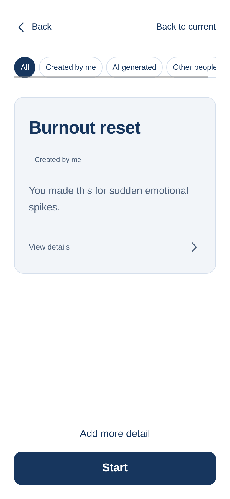
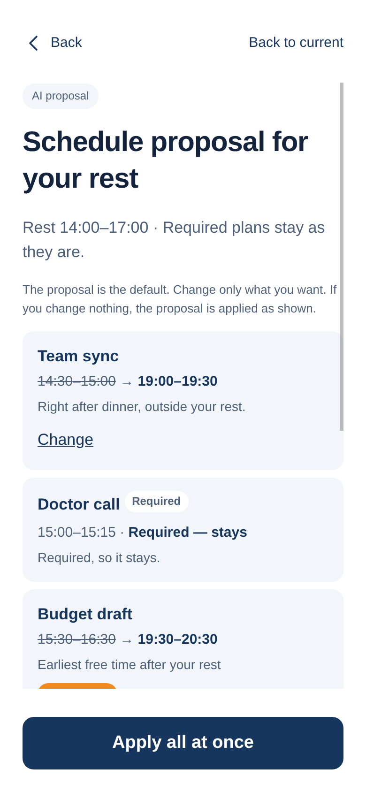
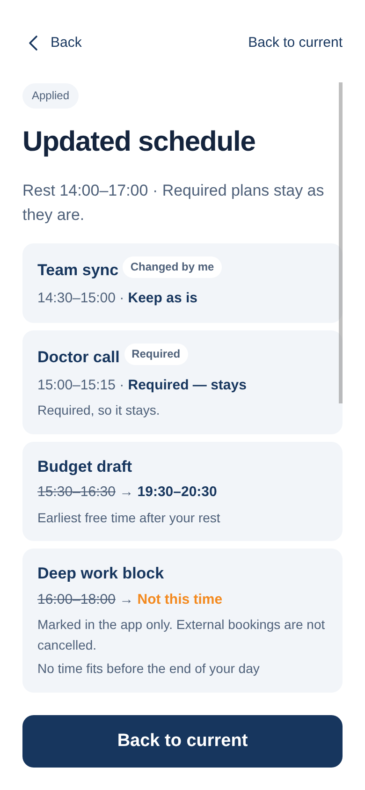

# Rest mode: AI batch reschedule

When a rest routine starts (for example, a 3-hour *Burnout reset*), the change summary opens with a proposal already filled in. Meta suggests what to do with each affected plan. The shared Kotlin rules check every suggestion, and the user applies everything with one button.

## Flow

```
web (app.js) ── POST /api/rest/proposal ──▶ Python rest_reschedule.py
                                             ├─ KMP /reschedule/preview        (rule plan + affected plans)
                                             ├─ Meta muse-spark-1.3, one call  (skipped if off or failing)
                                             └─ KMP /reschedule/preview + suggestions (validation)
web ── POST /api/execution/reschedule/apply (dryRun or apply) ──▶ KMP validates, then saves
```

- The rest window starts at the rest run's start event and lasts `restMinutes`. Reopening the screen never extends or restarts it.
- The end of the day defaults to 21:00.
- All validation lives in one place: `RestRescheduler` in the shared KMP core (`apps/watch-proof/shared`). Preview and apply use the same validator.

## Choices per item

| Choice | Effect |
| --- | --- |
| As proposed | Default |
| Move to another time | Checked before apply |
| Not this time | Shown in the app only. External bookings are not cancelled. |
| Keep as is | The plan stays where it is |
| Decide later myself | Goes to a "decide later" list. No time is invented for it. |

Required plans have no change button. Plans that cannot move offer only *keep* or *not this time*. If nothing is changed, the whole proposal is applied.

## Validation codes

| Code | Blocks |
| --- | --- |
| `OVERLAP` | Overlap with plans that stay or other moved plans |
| `INSIDE_REST_WINDOW` | Moving into the rest window |
| `PAST_DAY_END` | Ending after the end of the day |
| `PAST_DEADLINE` | Ending after the plan's deadline |
| `REQUIRED_FIXED` | Changing a required plan |
| `NOT_MOVABLE` | Moving a plan that cannot move, or deferring it |
| `UNKNOWN_ID` / `NOT_AFFECTED` | An unknown id, or a plan outside the rest window |
| `DUPLICATE` / `MISSING` | The same item twice, or a missing item |
| `MISSING_TIME` / `BAD_ACTION` | A move with no time, or an unknown action |

A suggestion that fails is shown as **Needs check** with the time struck through. It is never offered as a usable time. In its place the app uses the rule-based alternative: the earliest free slot of the same length after the rest window, within the deadline and the end of the day. If there is no such slot, the item becomes *not this time*.

## Apply

- The whole set is validated again when applied. If any item fails, nothing changes and the reply lists a reason for each item.
- Apply is idempotent:
  - Repeating the same id returns the stored result.
  - Sending the same choices under a new id returns `ALREADY_APPLIED`.
  - Sending different choices under the same id returns `COMMAND_CONFLICT`.
  - If the schedule changed in between, the reply is `STALE_REVISION`.
- A moved plan keeps its id. Its original time is kept in `history`.
- Runs that are already in progress are never touched.

## Meta failures

On a timeout or a bad reply, input and state stay as they were, and the screen shows a **rule-based plan**. There is no automatic retry. A cached result is reused for the same rest run, the same schedule revision and the same language, so reopening the screen never pays twice. Only the user's *Ask AI again* button calls Meta again. Without `--meta`, the plan is always rule-based.

## Reservation fields

- **Required** (default off)
- **Can change time** (default on)
- **Deadline** (optional)

Older reservations load with these defaults.

## Screens

| Recommendation | Rest proposal | Applied |
| --- | --- | --- |
|  |  |  |

The screenshots come from headless Chromium at a mobile viewport, with a mock Meta reply.
